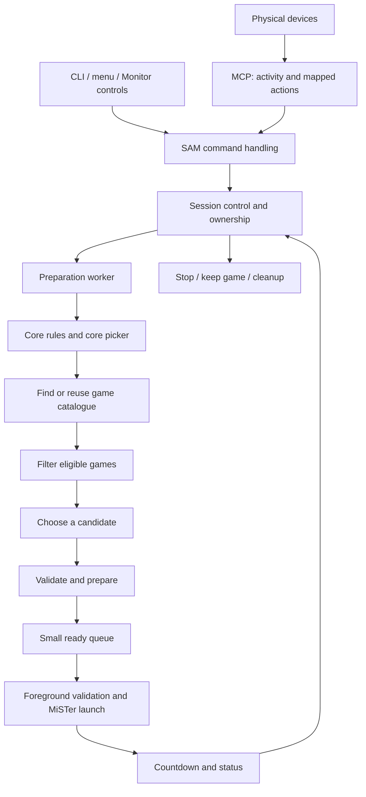

# SAM functionality and modular design overview

Source audit: **2026-10-11**, local `test` commit **`b02c1c3`**.

This is the baseline audit before the resident Python owner switch. **Current**
below means that audited revision. The picker/filter/launch descriptions remain
useful, but current ownership, mode progression and controls are documented in
[SESSION_ENGINE.md](SESSION_ENGINE.md) and [ARCHITECTURE.md](ARCHITECTURE.md).

This document maps the current implementation and proposes a clearer module
contract. Sections marked **Current** describe existing behavior. Sections marked
**Proposed** are a design direction, not an implemented API. This document does
not change runtime behavior.

## 1. The mental model

SAM has five main responsibilities:

| Responsibility | Plain-language purpose |
| --- | --- |
| MCP | Decide when to request SAM; observe physical activity |
| Selection | Decide what game or video to present |
| Session engine | Own the session, timer, transitions and cleanup |
| MiSTer backend | Perform hardware operations and observe their results |
| Menu and displays | Show state and request SAM actions |

SAM is currently partly modular. Core rules, filters and preparation are shared,
but M82 and commercial/video mode replace the normal loop. MCP also contains
M82-specific behavior. The proposed destination is **one session engine**, with
explicit mode policies, composable filters/add-ons and platform adapters.

## 2. Current: entry points and processes

- `MiSTer_SAM_on.sh` is the public entry point. It routes diagnostics, updates and
  control requests early. Its caller layer opens menus and monitors without
  initializing the full selection engine.
- MCP is a long-lived Python process in its tmux session. It discovers devices,
  caches mappings, observes idle time and submits SAM actions.
- The foreground SAM Bash process owns the session. Ownership uses **PID plus
  process start ticks**, preventing an unrelated reused PID from becoming owner.
- Normal mode has at most one low-priority preparation worker and a queue of up
  to two prepared candidates. BIOS-skip/launch helpers have separate ownership.
- Menu and CLI callers are short-lived. There is no additional general command
  broker or control daemon.

A start request is admitted under a start lock. It checks existing ownership,
startup and menu activity, validates an explicit core and prevents competing
starts. Automatic `--if-idle` requests preserve an existing owner. Runtime
initialization loads configuration, metadata, services and enabled modules only
when needed.

## 3. Current: the normal game-selection pipeline



This diagram describes normal mode. M82 and video currently use a separate
compatibility path, described below.

### 3.1 Establish requested and allowed cores

SAM maintains three related lists:

1. **Requested cores:** the user's configured systems, normalized and deduplicated.
2. **Allowed cores:** requests that satisfy current module rules and session
   exclusions.
3. **Remaining rotation:** allowed cores still available in the current cycle.

`core_requested` hooks can alter requests. `core_allowed` hooks accept or reject
each system with a reason. Examples include M82 requesting NES, BGM excluding
systems without its required volume control, and Arcade category presets limiting
selection to Arcade.

Explicit single-core commands still undergo validation. Candidate/game cores
and auxiliary playback cores have separate roles, so a video playback core need
not be treated as an ordinary game candidate.

### 3.2 Choose a core

Normal selection randomly chooses from the remaining rotation. Optional core
weighting uses available filtered game counts; missing catalogs may need
preparation before their counts are usable.

Bootstrap can favor Arcade for a quick initial candidate. The preparer can also
retain its first usable bootstrap core while preparing initial entries. Rotation
and no-repeat state are committed after successful launch dispatch, rather than
merely when a speculative candidate is chosen.

### 3.3 Find or reuse the master catalogue

| Platform | Discovery source |
| --- | --- |
| Ordinary consoles and supported CD systems | `samindex`, catalog folders and media extensions |
| Arcade / ST-V | `.mra` discovery |
| ao486 / X68000 / custom collections | Existing `.mgl` files |
| Amiga | MegaAGS/AmigaVision game and demo listings |

Ordinary scanning discovers matching folders under configured FAT, USB and network
roots and keeps complete media paths. ZIP entries retain their archive/member
paths. Cached ZIP central directories avoid extracting games. Directory symlinks
are tracked to avoid traversal loops.

Special-platform discovery is less uniform. Some MGL searches use explicitly
listed locations; Amiga resolves a collection directory and checks pack/core
prerequisites. These differences belong in platform adapters.

Complete lists are sorted and published atomically. Unchanged persistent lists
are not rewritten. A first Arcade bootstrap can publish 64 MRAs and complete its
catalog later. Further discovery/refresh is incremental, after preparing ready
slots, rather than an all-system startup prerequisite.

A storage failure during scanning is an error, not proof that a collection is
empty. Existing lists should survive unsuccessful scans.

### 3.4 Apply filters

The current normal-mode order is:

1. Module filter-policy adjustments.
2. Path filters and legacy Arcade orientation.
3. Deduplication.
4. Category exclusion files.
5. Ignore entries.
6. Kids or mature-rating filters.
7. Configured exclusion expressions.
8. Static-screen blacklist.
9. Module `candidate_filter` hooks: category, curated selection and artwork when
   enabled, followed by custom plug-ins in their load order.

**Artwork stays after deduplication.**

Normal deduplication keeps one identical basename; differently named regions and
revisions normally remain distinct. Strict deduplication groups more versions by
stripping tags/extensions and rejects some hack/beta/prototype names. It retains
the first surviving sorted path, rather than applying a universal popular-copy
ranking policy.

Complete paths remain authoritative. However, basename deduplication can collapse
same-named copies across storage, with sorted-path order determining the winner.

Kids mode requires reviewed whitelist matches; a missing whitelist yields no
candidates. Category filtering can use folders, metadata and curated fallback
lists. Arcade orientation also gets a check against the selected MRA.

Filtered normal catalogs and counts are cached in RAM using source, settings and
module stamps. Artwork additionally maintains persistent matching indexes,
eligibility results and downloaded-cover caches.

### 3.5 Choose a ROM and prepare it

The normal ROM picker chooses from the eligible catalog. With `norepeat`, it
excludes already committed paths and entries reserved by the preparation queue.
When the cycle is exhausted, selection proposes a cycle reset for later commit.

Candidate validation checks the media file or containing archive, extension and
platform prerequisites. Amiga title-based launches do not require an ordinary
ROM file for each title.

`candidate_prepare` hooks perform additional work, such as checking actual MRA
orientation and obtaining/decoding the selected cover. Artwork has two stages:
inexpensive names/index matching, then selected-cover availability and decode.
A database match alone is not the final decoded-cover guarantee. Large CD images
are excluded from the artwork resolver's small-ROM CRC fallback.

The preparer publishes a record bound to the owner and policy revision. It does
not launch a game or commit play history.

### 3.6 Revalidate, launch and commit

The foreground checks the prepared record against current ownership, policy,
core rules, Ignore entries, media/container existence and `launch_validate`
hooks. Stale or disallowed candidates are discarded.

The loader prepares a platform-specific launch, audio protection and post-launch
helpers, then dispatches the MiSTer command. After a successful dispatch result,
normal mode commits rotation/no-repeat state, retains current/previous records
and starts its timer. The preparer fills successors while the foreground handles
controls.

**A successful command write is not a universal game-ready acknowledgement.**
The ordinary loader currently includes a one-second sleep; BIOS skipping runs
separately. Successful boot, expected core observation and accepted command
delivery need distinct meanings.

If discovery and filtering are exhausted without an eligible game, normal mode
publishes an explicit empty outcome and stops. Its automatic-start guard avoids
retrying the same empty configuration indefinitely. I/O failures remain distinct
from a valid empty result.

## 4. Current: MCP and input detection

```text
Physical discovery → cached bindings → input observation → mapped action
                   → lifecycle coordinator → command gateway → session/backend
```

Device discovery recognizes physical joystick, keyboard HID and mouse devices,
including Bluetooth UHID. Identified software virtual devices are excluded.
Reconnects compare device generations, so reusing `jsN` still rebuilds bindings.

Mapping precedence is valid saved MiSTer global mappings, controller database,
then generic activity. Explicit unassignment and ambiguous definitions are not
guessed. Mapping/device metadata stays outside the 20 ms joystick polling loop.

Joystick readers reopen joydev for startup-state snapshots because MiSTer Main
can grab devices during gameplay. Fresh readers seed held state. Keyboard/mouse
readers are separate; raw HID activity does not necessarily supply key names.

The existing one-second checker observes idle time, session ownership, the core
marker and configuration changes. With `menuonly` enabled, ordinary manual
gameplay pauses physical readers; Menu and SAM startup/running resume them.
Unknown core state is treated conservatively. Ordinary Menu observation uses the
core marker's `MENU` value, rather than testing whether `menu.rbf` exists.

While normal SAM runs, default/exit usually requests Menu; mapped Start can keep
the game; Next can skip or Ignore-and-skip. Startup input can cancel the tracked
launcher, and busy navigation retains a coalesced Stop for the exact owner.
Menu/console reservations and Scripts-origin handoff suppress UI dismissal input.
Zaparoo has a separate replacement/activity path.

MCP currently knows M82 phases. It consumes ordinary exit/skip mappings, requests
M82 play in the game demonstration phase, and leaves subsequent gameplay input
in the game. External Menu after an M82 game stops that owner; automatic restart
requires a fresh Menu idle interval.

**Disabling device observation and disabling exit-on-button behavior are different
policies.** M82 needs to observe its first play press. After play begins, it may
no longer need those MCP readers. Turning off every reader immediately would
also prevent detection of that first press.

## 5. Current: launch, timers, configuration and cleanup

### Platform execution

`load_core` currently combines policy checks, platform preparation, audio,
display/log observation and hardware dispatch:

- Arcade/ST-V launches an MRA.
- Ordinary consoles generate an MGL from the same catalog used by the scanner:
  RBF alias, media slot, method/index, delay/reset behavior and full media path.
- Existing MGLs launch directly.
- Amiga stages temporary shared data and an AGS boot title, then launches its
  Amiga MGL/RBF.
- CD32 has a special config-file path rewrite and delayed start helper.
- BIOS skip sequences run as owned jobs canceled on subsequent launch or exit.

These platform-specific operations should be separate from choosing a game.

### Timers and live configuration

The normal timer handles terminal keys through timed Bash reads. Idle ticks use
built-in checks; pending controls invoke their claim/ack path when present. A zero
normal timer is genuinely indefinite.

Compatibility modes have a separate timer loop for M82 play activation and video
duration synchronization. M82 currently represents a zero play timer using an
86,400-second deadline plus an infinite-display flag. A shared timer contract
should represent indefinite duration explicitly.

Owner-bound RAM updates carry configuration changes. Selection changes cancel
and invalidate preparation at safe boundaries. Mode/module changes apply at the
next game boundary through a session replacement coordinated by MCP. Startup
INI loading supports trusted Bash; live reload has a more restrictive literal
parser, so their expression support differs.

### Displays, menus and exit

`SAM_state` is an atomic literal snapshot for Monitor: active/mode, game/path/core,
Arcade setname, start/timer, owner PID/start and whether the user kept the game.
The generic controls module publishes it without requiring Monitor to be present.
tty2oled additionally uses its own named-pipe and launch-context integration.

Normal/roulette menus wait for a selection-bound pause and resume when closed.
M82/video continue behind the menu. This is a responsiveness problem: the measured
active settings-dialog median was 1.23 s on main versus 3.72 s in the refactor.
Inactive medians were 1.17 s versus 0.63 s. The benchmark used private fixtures,
identical normal-mode settings and stubbed dialog drawing on the real MiSTer.

Stopping closes candidate publication and establishes that the old owner can no
longer launch. Owned jobs/helpers are canceled, critical temporary state is
restored, and Menu can be dispatched early once the launch barrier permits.
Remaining cleanup/audio work follows safely. Menu/audio restoration uses fresh
observations, ownership checks and bounded retries. Keep-game exit restores
SAM-owned audio; core-volume/BGM restoration can require reloading the captured
launch artifact. Required cleanup failures retain evidence and protection.

Ordinary manual launching remains MiSTer's responsibility. Cleanup should never
rewrite user preferences or operate on a replacement owner's resources.

## 6. Current: how M82 and video diverge

M82 loads compatibility selection, catalog and loop functions. It limits cores
to NES, constructs an ordered BIOS/game sequence from `m82_list.txt`, picks the
first entry and advances the list between launches. Demonstration duration is
21 seconds; play restores SAM-owned audio and applies the configured play timer.
Its behavior is spread across module, compatibility and MCP code.

Commercial/video mode schedules clips using mplayer or auxiliary CD-i playback.
Commercial metadata identifies the subsequent core/title; `commercial_picker`
resolves and ranks installed copies from the filtered list. Playback, clip
downloads, timers and subsequent game selection use the compatibility engine.

Both modes disable effective `Artwork_only` without rewriting the saved INI.
M82's special catalog branch returns before the ordinary base-filter call.
Module candidate hooks and launch checks remain, but filter coverage is not
identical to normal mode. Retry and list-maintenance behavior also differ.

## 7. Current: limits of the module system

`sam_register(event, function)` appends callbacks. `sam_bind(service, function)`
replaces a provider, with the last binding winning. M82/video exclusivity has a
specific check; there is no general provider-conflict contract.

| Current coupling | Consequence |
| --- | --- |
| M82/video replace the normal loop and ordinary function names | Different selection, retries and timers |
| Compatibility picker checks mode names | New modes require shared-code edits |
| MCP contains M82 decisions | Input policy is spread across languages/files |
| Hooks mutate globals or read caller locals | Dependencies are implicit |
| Last registration wins | Provider conflicts depend on source order |
| Filter order follows loading conventions | Guarantees can differ by mode |
| Launch code mixes policy, adapters and side effects | Execution is difficult to isolate |
| Commands use multiple delivery mechanisms | Acceptance/completion semantics vary |

Also, `SAM_MODE` means ALL/SINGLE while `sam_mode` means normal/M82/video. These
are different concepts and deserve unambiguous names.

## 8. Proposed: one engine and three extension types

| Extension | Owns | Must use shared engine facilities for |
| --- | --- | --- |
| Mode | Programme, selection strategy, phases, input/timer/menu/audio policy | Ownership, commands, execution, state, cleanup |
| Filter/add-on | Candidate restrictions, resources or observations | Ordered filtering and resource ownership |
| Platform adapter | Discovery, validation and launch-plan preparation | Actual MiSTer command execution |

Exactly one mode should own the programme. Multiple compatible filters/add-ons
can coexist. Platform variations common to many consoles should remain catalog
metadata rather than requiring a separate script per console.

A small mode contract could provide:

| Proposed callback | Output |
| --- | --- |
| `configure(context, policy_out)` | Core restrictions, source/selector and input/timer/audio/menu policies |
| `next(context, candidate_out)` | One proposed game, BIOS item or video |
| `on_event(context, event, decision_out)` | Action/timer decision after press, timeout, launch observation or Menu |
| `setup` / `cleanup` | Bounded resources registered through engine helpers |

The default providers implement normal random selection. A mode overrides only
the policy slots it needs. Multiple callbacks and exclusive providers are
different mechanisms: duplicate exclusive providers should cause a clear startup
error. Filter ordering, dependencies and capabilities should be declared.

Configuration hooks should not scan collections or download covers. Expensive
work belongs in owned preparation jobs. Callbacks should receive documented
contexts and return explicit outputs instead of depending on dynamic local scope.

### M82 as the first complete mode

| Aspect | Proposed M82 policy |
| --- | --- |
| Cores | NES only |
| Selection | Resolved ordered BIOS/game sequence |
| Artwork | Effectively off; saved preference preserved |
| BIOS/loading input | Ignore ordinary physical exit actions |
| Demonstration input | First press requests play |
| Playing input | Preserve gameplay; stop unnecessary MCP polling |
| Timer | Demonstration interval, then configured duration or indefinite play |
| Audio | Configured demo mute; restore SAM-owned mute for play, respecting user mute |
| External Menu | Stop this session; await a fresh Menu idle timeout |
| UI | Continue unless the mode supports a safe pause |
| CLI controls | Remain available independently of physical detection |

MCP should consume an effective input-policy snapshot. Mode-specific decisions
belong in the mode/engine, with a second owner/phase check when an action is
applied. A module needing no physical events can actually disable the readers;
one needing a first press retains only the required observation.

## 9. Proposed: SAM commands versus MiSTer execution

```text
CLI / UI / MCP / HTTP
    → SAM request
    → session ownership and mode-policy validation
    → platform launch plan
    → MiSTer execution and observation
    → state publication and acknowledgement
```

SAM commands include Start, Stop, Next, Previous, Pause, Resume, Play, Ignore,
status and configuration requests. They should not contain arbitrary shell code
or device writes.

The backend should own MiSTer load, volume and hardware-button operations,
readiness checks and bounded retry. The same verified path should serve all modes
and recovery after an owner dies. Distinguish **accepted**, **dispatched** and
**applied/observed** rather than treating a successful write as successful boot.

Requests should carry an ID and owner/launch/policy identity where relevant.
Repeated navigation can be coalesced; Stop must remain available. Stale requests
must not affect a replacement owner or new selection.

Current delivery uses verified tmux keys, RAM pending JSON with claim/ack,
short-lived backend processes/signals and direct hardware/service commands.
The gateway is useful, but owner-side handling is not yet unified.

The UI should accept interaction immediately and request the mode's pause or
continue policy asynchronously. Selection-specific actions require a verified
context. Closing should resume only the exact lease that UI acquired. This must
preserve ownership checks and never silently assume an unacknowledged pause.

### Explicit records

| Record | Important contents |
| --- | --- |
| Session context | Owner, effective configuration, policy revision, current phase |
| Candidate | System, title/identity, full media reference or title source, adapter, role, prepared metadata |
| Launch plan | Artifact/RBF, media slot, temporary setup/audio requirements, expected observation, owned post-launch work |
| Command | Action, request ID, expected owner/launch and acknowledgement state |

A BIOS/video/title launch should not have to pretend it is an ordinary ROM file.
Full media paths and archive members must survive selection and execution.

## 10. Proposed: readable responsibility layout

```text
MiSTer_SAM_on.sh       thin caller and routing
lib/commands.sh        SAM command validation and acknowledgement
lib/engine.sh          session state machine and resource ownership
lib/selection.sh       core/ROM strategy, prepared queue and history
lib/catalog.sh         discovery and caching
lib/filters.sh         declared filter pipeline
lib/backend.sh         MiSTer execution and readiness
lib/status.sh          authoritative published state
modes/                normal, M82, commercial, roulette
filters/              artwork, category, Kids, curated selection
adapters/             MGL, MRA, Amiga and special CD32 preparation
integrations/         BGM, tty2oled, Monitor
mcp/                  readers, cached bindings and command production
```

This is a responsibility map, not a requirement to create every file immediately.
Keep Bash coordination and existing Python 3.9 helpers. No additional resident
broker, general plugin framework or large collection of new INI switches is
needed.

## 11. Proposed: three mandatory fast paths

These are architectural acceptance criteria, not optional tuning:

1. Physical input, including relevant physical hotplug, must take the urgent
   Menu-return path when the active mode uses default exit-to-menu behavior.
2. Starting SAM must reach its first eligible presentation quickly.
3. Opening a menu or issuing a command must avoid initializing unrelated runtime
   components and must become interactive/respond promptly.

Mode-specific input behavior remains authoritative: M82 gameplay input must not
be turned into ordinary exit-on-press. Confirmed physical hotplug follows the
active mode's explicit policy; software virtual-device churn is excluded.

### Input and hotplug to Menu

Use the existing warm MCP and cached input mappings to submit urgent Stop.
The engine accepts Stop before ordinary navigation or background completions.
Close launch admission and cancel any outstanding hardware-dispatch job before
Menu dispatch. Only critical temporary-state restoration belongs before it;
preparation termination, logs and noncritical service/display cleanup can finish
in the background once they cannot launch or alter the new core.

Do not run the CLI, load modules, rebuild mappings or scan collections before
handling a known physical input. For hotplug, separate cheap physical-device
classification/urgent response from full binding discovery. Debouncing metadata
rebuilds must not delay a confirmed physical event's required response. Fresh
readers must become usable quickly and retain safe held-state initialization.

Observe fresh Menu state and restore SAM-owned audio in the correct order.
Retain ownership checks and bounded delivery retries during a core change.

### Start to first presentation

Use a valid cached eligible candidate/launch plan when available. Validate its
current policy, media and required artwork before dispatch. Maintain a small
startup seed cache on catalog/policy changes rather than writing a new seed to
SD after every game. This cache must never override current filters or single-core
requests.

On a cache miss, prepare only one usable item/core first. Dispatch it as soon as
ready; fill successors, discover other systems and refresh optional metadata
afterward. Do not require the two-item queue or an all-system catalogue to be
complete before launching the first item.

Preparation must publish its first completed item before doing optional follow-up
work. Configuration hooks must not scan ROMs or download player assets. Required
initial setup has an explicit setup/error path. Missing artwork still requires
preparation or an error; fast startup cannot bypass eligibility.

M82 BIOS and commercial/video clips are intentional programme items. Measure
Start-to-first-presentation and the later game transition separately, excluding
intentional playback duration from engine overhead.

### Caller to menu or command response

Route commands through the thin caller. Status/help/monitor/menu requests must not
load ROM metadata, filters, audio setup, optional players or mode implementation
code they do not need. Read a cached effective UI/state snapshot where available.

Render an interactive menu immediately. Submit the mode's pause/continue request
asynchronously; verify selection-specific actions and the exact resume lease
without blocking the entire UI. Cosmetic monitor formatting is never an
attachment prerequisite.

### Measurement and initial budgets

Record separate monotonic timestamps for detection, engine acceptance, first
hardware dispatch attempt and observed Menu/core readiness. Measure menu input
readiness, not merely its banner. Test cold/warm startup, active/inactive menu,
input during preparation/loading, Bluetooth reconnect and heavy CPU load.

Initial software targets to validate on MiSTer:

| Path | Initial target |
| --- | --- |
| Physical event to urgent Stop acceptance | Within about 100 ms |
| Menu becoming genuinely interactive | Within about 500 ms |
| Ordinary cached control acknowledgement | Within about 100 ms |
| Start to first launch attempt with a valid local prepared seed | Within about 500 ms |

These targets are not achieved benchmark results or guarantees of FPGA boot
time. Separately report the first safe Menu dispatch attempt and actual observed
Menu latency. Missing caches, required cover downloads and hardware loading must
be timed explicitly. Reject improvements that just move waiting elsewhere or
weaken launch, artwork, audio or ownership guarantees.

## 12. Efficiency, guarantees and migration

Preserve the useful existing foundation:

- One preparation worker and a small bounded queue.
- Atomic RAM records and exact ownership checks.
- Cached ZIP directories and unchanged-list publication.
- Delayed loading of optional components.
- No process, DB lookup, hashing or redraw for unchanged physical samples.
- Distinct empty/no-match, retryable and fatal outcomes.
- Candidate order/history committed after accepted execution.
- Policy-revision invalidation without blindly discarding healthy caches.
- Idempotent cleanup of owner-registered resources.
- Menu return after launch quiescence, followed by safe remaining cleanup.

Add explainable decisions: effective core/input/filter policy, per-filter counts
and last selection/rejection reasons. An explain operation should use cached
state rather than trigger another all-ROM scan.

Recommended migration order:

1. Define and test policy, candidate, launch and command contracts, including
   provider conflicts and resource ownership.
2. Move M82 onto the shared engine. Verify BIOS/game/play/Menu, input, audio,
   explicit Stop and timer behavior before removing its compatibility path.
3. Unify owner-side command handling and backend execution. Use that contract to
   make menu pause/resume asynchronous while preserving exact-context safety.
4. Extract platform adapters and pass explicit contexts to integrations.
5. Move commercial/video scheduling onto the same candidate/event pipeline.
6. Remove duplicate compatibility implementations and state after equivalent
   behavior passes. Gate progress on measured menu/input/Stop latency and module
   compatibility, as well as code readability.

## 13. Current source pointers

| Concern | Source |
| --- | --- |
| Public entry and loading | [entry](../MiSTer_SAM_on.sh), [caller](../.MiSTer_SAM/lib/caller.sh), [runtime](../.MiSTer_SAM/lib/runtime.sh) |
| Module registry | [modules](../.MiSTer_SAM/lib/modules.sh), [current module API](MODULE_API.md) |
| Core rules and random policy | [cores](../.MiSTer_SAM/lib/cores.sh), [policy](../.MiSTer_SAM/lib/policy.sh) |
| Discovery and eligibility caches | [catalog runtime](../.MiSTer_SAM/lib/catalog-runtime.sh), [catalog builders](../.MiSTer_SAM/lib/catalog.sh), [scanner](../.MiSTer_SAM/samindex.py) |
| Base filters and Ignore | [filter](../.MiSTer_SAM/lib/filter.sh) |
| Normal worker, queue and timer | [engine](../.MiSTer_SAM/lib/engine.sh) |
| Launch and MGL creation | [launch](../.MiSTer_SAM/lib/launch.sh), [MGL generator](../.MiSTer_SAM/sam_mgl.py) |
| Compatibility engine | [loop](../.MiSTer_SAM/modules/compat-loop.sh), [selection](../.MiSTer_SAM/modules/compat-selection.sh), [catalog](../.MiSTer_SAM/modules/compat-catalog.sh) |
| M82 and video | [M82](../.MiSTer_SAM/modules/m82.sh), [M82 functions](../.MiSTer_SAM/modules/m82-functions.sh), [video](../.MiSTer_SAM/modules/video.sh) |
| Physical inputs and mode routing | [MCP](../.MiSTer_SAM/MiSTer_SAM_MCP.py), [coordinator](../.MiSTer_SAM/sam/coordinator.py), [input documentation](MCP_INPUT.md) |
| Command delivery | [gateway](../.MiSTer_SAM/sam/commands.py), [control transport](../.MiSTer_SAM/control/sam_control.py) |
| Live configuration | [config reload](../.MiSTer_SAM/lib/config-reload.sh) |
| Cleanup and audio | [session](../.MiSTer_SAM/lib/session.sh), [lifecycle](../.MiSTer_SAM/lib/lifecycle.sh), [audio](../.MiSTer_SAM/lib/audio.sh) |
| Published state | [state](../.MiSTer_SAM/control/state.sh), [controls module](../.MiSTer_SAM/modules/controls.sh) |

This is an inspection snapshot. Update it when migration changes a responsibility,
contract, filter order or mode behavior; keep proposed behavior labeled until it
has been implemented and validated.

The [session-engine research](SESSION_ENGINE_RESEARCH_2026-10-11.md) records the
next-stage executable prototype and measured boundaries. It does not replace the
production paths documented here.
